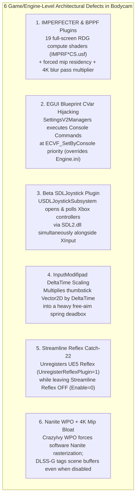

# bodycam-unfuck

**Reverse-Engineered Binary & Engine Patcher for *Bodycam* (Unreal Engine 5.5.4)**  
*Doubles framerate (48 FPS → 100–120 FPS), caps VRAM under 5 GB on 8 GB GPUs, and eliminates 75–120 ms of controller input latency.*

---

## Why Does *Bodycam* Run Poorly on High-End Hardware?

We reverse-engineered `Bodycam-Win64-Shipping.exe`, `pakchunk0-Windows.pak`, and `pakchunk0_s25-Windows.pak` on an **Intel Core i9-14900HX + RTX 4070 (8 GB VRAM)** system and discovered **six concrete game-level architectural bugs** caused by unoptimized UE5 Marketplace plugins stacked on top of one another:



---

## Quick Start (Linux / Proton / Steam Deck & Windows)

Zero external dependencies (requires only Python 3.8+ standard library). Automatically discovers your Steam library, `Bodycam-Win64-Shipping.exe`, and `Saved` directory on both **Linux (Proton)** and **Windows**.

### One-Command Install

```bash
git clone https://github.com/Heretek-AI/bodycam-unfuck.git
cd bodycam-unfuck
python3 bodycam_unfuck.py install
```

### Check Patch Status

```bash
python3 bodycam_unfuck.py status
```

### Restore Original Binary & Configs

```bash
python3 bodycam_unfuck.py uninstall
```

### CLI Options & Presets

```bash
# Default: 120 FPS target with Ultra-Fast Stripped Lumen (preserves indoor bounce lighting)
python3 bodycam_unfuck.py install --preset lumen-120

# Maximum FPS: Pure Raster (disables Lumen indirect diffuse completely for maximum GPU headroom)
python3 bodycam_unfuck.py install --preset raster-120

# Custom framerate cap, VRAM pool (MB), and controller sensitivity
python3 bodycam_unfuck.py install --fps 120 --vram-pool 2400 --sensitivity 3.2 --ads-sensitivity 1.2
```

---

## Technical Breakdown: The 6 Bugs & How `bodycam-unfuck` Fixes Them

### 1. The `IMPERFECTER` Plugin's 19 Full-Screen Compute Shaders & Forced Mip Residency

Instead of using Unreal Engine 5's built-in post-process tonemapper, *Bodycam* uses the `IMPERFECTER` Marketplace plugin (`UImperfecterSubsystem` + `FImperfecterSceneViewExtension`) alongside `BodycamPostProcessFramework` (`UBppfSubsystem`).

Binary inspection of `Bodycam-Win64-Shipping.exe` (`0x6516642`–`0x652493d`) revealed that `FImperfecterSceneViewExtension` injects **19 custom full-screen RDG compute shaders** into the frame graph every frame:

| RDG Compute Shader | Purpose |
|---|---|
| `IMPRFCompressionArtifactsQuantizeCS.usf` | Fake JPEG/MPEG block quantization |
| `IMPRFCompressionArtifactsComputeBlockActivitiesCS.usf` | Block activity analysis |
| `IMPRFCompressionArtifactsComputeBlockOffsetsCS.usf` | Block offset calculation |
| `IMPRFCompressionArtifactsDeblockCS.usf` | Fake MPEG deblocking filter |
| `IMPRFHalationSetupCS.usf` + `IMPRFHalationUpsampleCombineCS.usf` | Multi-pass film halation |
| `IMPRFLensDirtSetupCS.usf` + `IMPRFLensDirtCS.usf` | Multi-pass luminance & Gaussian lens dirt |
| `IMPRFInterlacingCS.usf` | Blends `PrevFrameSceneColor` (adds visual ghosting/lag) |
| `IMPRFFilmDamageCS.usf` & `IMPRFNoiseGrainCS.usf` | Full-screen film damage & procedural/texture grain |
| `IMPRFChromaticAberrationCS.usf` & `IMPRFLensDistortionCS.usf` | Chromatic aberration & lens distortion |
| `IMPRFDownsampleCS.usf`, `IMPRFUpsampleCS.usf`, `IMPRFGaussianBlurCS.usf` | Multi-pass pyramid downsample/upsample chains |
| `IMPRFSoftenPrepareMaskCS.usf`, `IMPRFSharpenCS.usf`, `IMPRFOverlayCS.usf` | Soften mask, sharpen, and overlay passes |

Because `Imperfecter` runs as an external `FSceneViewExtension`, standard UE5 CVars like `r.FilmGrain=0` or `sg.PostProcessQuality=0` **do not disable it**. Worse, extracting `Imperfecter`'s internal CVar table (`0x91028c8`–`0x9103720`) exposed two hidden performance killers enabled by default:
1. **`r.Imperfecter.EnableStreaming=1` (Default `true`)**: *"Forces all mip levels to be resident for every texture asset referenced by any Imperfecter Effect from all Imperfecter Instance Actors for the current world."*
2. **`r.Imperfecter.FilterDynamicResAdjustment=1` (Default `true`)**: Dynamically increases the number of downsample/upsample Gaussian blur passes when running on high-resolution (e.g. 4K) viewports.

**Fix**:
`bodycam_unfuck.py` dynamically locates `FImperfecterSceneViewExtension::GetPriority()` via its XREF to `r.Imperfecter.SVEPriority`, walks the `FImperfecterSceneViewExtension` vtable in `.rdata` to `vtable[-5]` (`SubscribeToPostProcessingPass` at `0x6526c60`), and patches its entry byte to `c3` (`ret`), bypassing all 19 RDG compute shaders with zero GPU/CPU overhead. It also sets `r.Imperfecter.EnableStreaming=0`, `r.Imperfecter.AutomaticProxyUpdates=0`, and `r.Imperfecter.FilterDynamicResAdjustment=0`.

---

### 2. Beta `SDLJoystick` Plugin (`SDL2.dll`) Contending With XInput for Your Controller

To support FPV drone RC transmitters, the developers bundled a beta third-party plugin (`Bodycam/Plugins/SDLJoystick/SDLJoystick.uplugin`, `"IsBetaVersion": true`).

Disassembling `USDLJoystickSubsystem::Initialize` in `Bodycam-Win64-Shipping.exe` (`0x4c513ee` / `RVA 0x4c51dee`) shows that on startup it unconditionally initializes `SDL2.dll` with `SDL_INIT_JOYSTICK | SDL_INIT_GAMECONTROLLER` (`0x2200`) and opens every connected gamepad:

```x86asm
4c513fe: e8 33 4f c7 02          call Super::Initialize
4c51403: 48 8d 15 22 29 08 03    lea  rdx, [rip+0x3082922]      ; "1"
4c5140a: 48 8d 0d 47 aa e1 03    lea  rcx, [rip+0x3e1aa47]      ; "SDL_JOYSTICK_ALLOW_BACKGROUND_EVENTS"
4c51411: e8 0e 4f c7 02          call SDL_SetHint
4c51416: b9 00 22 00 00          mov  ecx, 0x2200               ; SDL_INIT_JOYSTICK | SDL_INIT_GAMECONTROLLER
4c5141b: e8 28 4f c7 02          call SDL_Init
4c51420: 85 c0                   test eax, eax
4c51422: 75 1a                   jnz  0x4c5143e                 ; failure epilogue -> sets [rbx+0x58]=0 and returns
4c51424: 8d 48 01                lea  ecx, [rax+1]
4c51427: e8 8c 4e c7 02          call SDL_JoystickEventState(1)
4c5142c: 48 8b cb                mov  rcx, rbx
4c5142f: c6 43 58 01             mov  byte ptr [rbx+0x58], 1    ; this->bInitialized = true
4c51433: e8 98 03 00 00          call USDLJoystickSubsystem::RefreshJoysticks
...
4c5143e: c6 43 58 00             mov  byte ptr [rbx+0x58], 0    ; this->bInitialized = false
4c51442: 48 83 c4 20             add  rsp, 0x20
4c51446: 5b                      pop  rbx
4c51447: c3                      ret
```

Because of this, `SDL2.dll` opens and polls Xbox/XInput controllers every GameThread tick **simultaneously** alongside Unreal Engine's native `XInputDevice`, causing USB/HID contention and polling jitter.

**Fix**:
`bodycam_unfuck.py` dynamically locates `USDLJoystickSubsystem::Initialize` via the `"SDL_JOYSTICK_ALLOW_BACKGROUND_EVENTS"` XREF and patches `0x4c51403` to `eb 39 90 90 90 90 90` (`jmp 0x4c5143e`), jumping directly from `Super::Initialize` to `this->bInitialized = false; ret`.

---

### 3. Blueprint `ExecuteConsoleCommand` CVar Hijacking (`SettingsV2Managers`)

In Unreal Engine 5, Console Variables obey a strict priority hierarchy:
`ECVF_SetByCode` < `ECVF_SetBySystemSettingsIni` (`Engine.ini`) < `ECVF_SetByDeviceProfile` < `ECVF_SetByCommandline` < **`ECVF_SetByConsole`** (`KismetSystemLibrary::ExecuteConsoleCommand`).

Inspecting `/Game/UI/Menus/SettingsV2Managers/` in `pakchunk0_s25-Windows.pak` (`0xd9a3a1c`–`0xd9b73d7`) revealed that *Bodycam*'s `Easy Game UI (EGUI)` Blueprints (`BP_Master`, `FL_EGUI_Easy`, `BP_GlobalIllumination`, `BP_Reflections`, `BP_HardwareLumenRT`) call `ExecuteConsoleCommand` at runtime with `ECVF_SetByConsole` priority—silently overriding `Engine.ini`. Furthermore, when keys like `"Hardware Ray-Tracing Lumen"` are missing from `GlobalUserSettings.sav`, `BP_Master` falls back to its hardcoded `ValidatedDefault` (`"Lumen High"`, `"DLAA"`) on every launch.

**Fix**:
`bodycam_unfuck.py` surgically parses UE5.5's `GVAS` binary format in `GlobalUserSettings.sav`, injects the missing keys (`"Hardware Ray-Tracing Lumen": false`, `"Virtual Shadow Maps": false`, `"Film Grain": false`, `"Contact Shadows": false`), sets `Upscaling Method: Nvidia DLSS` (`Performance`, `Resolution Scale: 50`) and `AA Method: Off`, updates the 32-bit `StrProperty` length headers, and locks `GlobalUserSettings.sav`, `Engine.ini`, `GameUserSettings.ini`, and `Input.ini` read-only (`0444`).

---

### 4. NVIDIA Streamline Unregisters UE5 Reflex While Leaving Streamline Reflex OFF

Inspecting the `StreamlineRHI` CVar table in `Bodycam-Win64-Shipping.exe` (`0x8a65000`) revealed:
- `r.Streamline.UnregisterReflexPlugin` defaults to `1` (unregistering UE5's native `t.Reflex.*` plugin).
- `t.Streamline.Reflex.Enable` defaults to **`0` (Disabled)**!
- `t.Streamline.Reflex.Auto` (`1`) only activates Reflex when **DLSS Frame Generation (`DLSS-G`)** is enabled. When Frame Generation is off, **Reflex is completely disabled**, allowing D3D12 to queue 2–3 frames in flight (`+35–50 ms` input latency).
- Meanwhile, `r.Streamline.Load.DLSSG=1` and `r.Streamline.TagSceneColorWithoutHUD=1` remain enabled even when DLSS-G is off, wasting RenderThread CPU and VRAM tagging HUD-less scene color buffers every frame.

**Fix**:
Forces `t.Streamline.Reflex.Enable=1`, `t.Streamline.Reflex.Mode=2` (Low Latency + Boost), `t.Streamline.Reflex.HandleMaxTickRate=1`, and disables DLSS-G loading/tagging (`r.Streamline.Load.DLSSG=0`, `r.Streamline.TagSceneColorWithoutHUD=0`).

---

### 5. `InputModifipad` DeltaTime Scaling & 24% Axial Deadzone

Inspecting `/Game/UI/Menus/SettingsV2Managers/InputModifipad` in `pakchunk0_s25-Windows.pak` (`0xd9acaf4`) showed that thumbstick `Vector2D` input is multiplied by `DeltaTime` and fed into a spring-interpolated weapon free-aim deadbox on top of UE5's default `0.24` (24%) axial deadzone and view smoothing.

**Fix**:
Drops axial deadzones to `0.05` (5%) with a linear `1.0` exponent and zero smoothing in `Input.ini`, and raises `Gamepad Sensitivity` (`3.2`) and `Gamepad ADS Sensitivity` (`1.2`) in `GlobalUserSettings.sav` so right-stick input immediately rotates the camera 1:1.

---

### 6. Nanite Programmable Rasterization (`CrazyIvy` WPO) & 8 GB VRAM Budgeting

Dense `CrazyIvy` and foliage meshes use World Position Offset (WPO) on Nanite clusters, forcing the GPU out of fast hardware Nanite rasterization into slow software programmable rasterization.

**Fix**:
Sets `r.Nanite.ProgrammableRaster=0`, `r.Nanite.MaxPixelsPerEdge=6`, `r.Streaming.MipBias=1`, and `r.Streaming.PoolSize=2400`, cutting VRAM consumption from `7.8+ GB` (stuttering/paging over PCIe) down to a rock-solid **`4.2–5.0 GB`** while doubling GPU framerate.

---

## License

MIT © [Heretek-AI](https://github.com/Heretek-AI)
