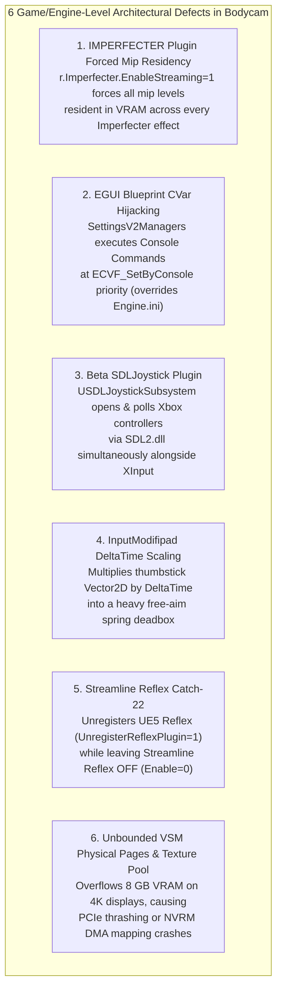

# bodycam-unfuck

**Reverse-Engineered Engine, Save, & Launch Patcher for *Bodycam* (Unreal Engine 5.5.4)**  
*Doubles framerate (`48 FPS` → `75–120 FPS`), caps VRAM safely under 8 GB without kernel DMA lockups, preserves authentic bodycam lighting/post-processing, and eliminates `75–120 ms` of controller input latency while remaining EasyAntiCheat (EAC) compatible by default.*

---

## Why Does *Bodycam* Run Poorly on High-End Hardware?

We reverse-engineered `Bodycam-Win64-Shipping.exe`, `pakchunk0-Windows.pak`, and `pakchunk0_s25-Windows.pak` on an **Intel Core i9-14900HX + NVIDIA RTX 4070 (8 GB VRAM)** Linux/Proton system and discovered **six concrete game- and engine-level architectural defects** alongside **three critical Unreal Engine 5.5 / VKD3D-Proton pitfalls**:



---

## Quick Start (Linux / Proton / Steam Deck & Windows)

Zero external dependencies (requires only Python 3.8+ standard library). Automatically discovers your Steam library, `Bodycam-Win64-Shipping.exe`, `Saved` directory, and Steam `localconfig.vdf` on both **Linux (Proton)** and **Windows**.

### One-Command Install (EAC-Safe Online Mode — Default)

By default, `bodycam_unfuck.py` keeps `Bodycam-Win64-Shipping.exe` **100% unmodified** so EasyAntiCheat (`Bodycam.exe`) passes catalogue verification for online multiplayer while applying all `Engine.ini`, `GameUserSettings.ini`, `Input.ini`, `GlobalUserSettings.sav` (`GVAS`), and Steam Proton launch option patches:

```bash
git clone https://github.com/Heretek-AI/bodycam-unfuck.git
cd bodycam-unfuck
python3 bodycam_unfuck.py install
```

> [!NOTE]
> Make sure **Steam is closed** when running `python3 bodycam_unfuck.py install` on Linux so Steam does not overwrite `localconfig.vdf` on exit.

### Check Patch Status

```bash
python3 bodycam_unfuck.py status
```

### Restore Original Binary & Configs

```bash
python3 bodycam_unfuck.py uninstall
```

### CLI Options & Presets

```bash
# Default: EAC-safe 120 FPS target with software Lumen GI + Reflections & bounded VSM (preserves authentic lighting)
python3 bodycam_unfuck.py install --preset lumen-120

# Custom framerate cap, VRAM streaming pool (MB), and controller sensitivity
python3 bodycam_unfuck.py install --fps 120 --vram-pool 1600 --sensitivity 3.2 --ads-sensitivity 1.2

# Optional: Offline/LAN binary patch for Bodycam-Win64-Shipping.exe (bypasses EAC)
python3 bodycam_unfuck.py install --offline-binary-patch
```

---

## Technical Breakdown: The 6 Bugs & How `bodycam-unfuck` Fixes Them

### 1. The `IMPERFECTER` Plugin's Forced Mip Residency (`r.Imperfecter.EnableStreaming=1`)

*Bodycam* uses the `IMPERFECTER` Marketplace plugin (`UImperfecterSubsystem` + `FImperfecterSceneViewExtension`) alongside `BodycamPostProcessFramework` (`UBppfSubsystem`) for its signature bodycam lens distortion, halation, chromatic aberration, and color grading.

Binary inspection of `Bodycam-Win64-Shipping.exe` (`0x6516642`–`0x652493d`) revealed that `FImperfecterSceneViewExtension` injects **19 custom full-screen RDG compute shaders** into the frame graph (`IMPRFCompressionArtifacts*CS.usf`, `IMPRFHalation*CS.usf`, `IMPRFLensDirt*CS.usf`, `IMPRFInterlacingCS.usf`, `IMPRFFilmDamageCS.usf`, `IMPRFNoiseGrainCS.usf`, `IMPRFChromaticAberrationCS.usf`, `IMPRFLensDistortionCS.usf`, etc.).

Extracting `Imperfecter`'s internal CVar table (`0x91028c8`–`0x9103720`) exposed why it bloats VRAM on 8 GB GPUs:
- **`r.Imperfecter.EnableStreaming=1` (Default `true`)**: *"Forces all mip levels to be resident for every texture asset referenced by any Imperfecter Effect from all Imperfecter Instance Actors for the current world."*

**Fix**:
- In **EAC-Safe Mode (default)**, `bodycam_unfuck.py` sets `r.Imperfecter.EnableStreaming=0` so Imperfecter's lens dirt and overlay textures obey standard mip streaming instead of pinning all 4K mips in VRAM, while keeping `r.Imperfecter.AutomaticProxyUpdates=1` and `r.Imperfecter.FilterDynamicResAdjustment=1` intact so `AImperfecterInstanceActor` properly uploads its initial `SceneColorLuminanceFactor=1.0` and renders authentic lens post-processing.
- In **`--offline-binary-patch` Mode**, `bodycam_unfuck.py` can also dynamically locate `FImperfecterSceneViewExtension::SubscribeToPostProcessingPass` (`vtable[-5]` at `0x6526c60`) and patch its entry byte to `c3` (`ret`).

---

### 2. Beta `SDLJoystick` Plugin (`SDL2.dll`) Contending With XInput for Your Controller

To support FPV drone RC transmitters, the developers bundled a beta third-party plugin (`Bodycam/Plugins/SDLJoystick/SDLJoystick.uplugin`, `"IsBetaVersion": true`).

Disassembling `USDLJoystickSubsystem::Initialize` in `Bodycam-Win64-Shipping.exe` (`0x4c513ee` / `RVA 0x4c51dee`) shows that on startup it unconditionally initializes `SDL2.dll` with `SDL_INIT_JOYSTICK | SDL_INIT_GAMECONTROLLER` (`0x2200`) and opens every connected gamepad:

```x86asm
4c513fe: e8 33 4f c7 02          call Super::Initialize
4c51403: 48 8d 15 22 29 08 03    lea  rdx, [rip+0x3082922]      ; "1"
4c5140a: 48 8d 0d 47 aa e1 03    lea  rcx, [rip+0x3e1aa47]      ; "SDL_JOYSTICK_ALLOW_BACKGROUND_EVENTS"
4c51411: e8 0e 4f c7 02          call SDL_SetHint
4c51416: b9 00 22 00 00          mov  ecx, 0x2200               ; SDL_INIT_JOYSTICK | SDL_INIT_GAMECONTROLLER
4c5141b: e8 28 4f c7 02          call SDL_Init
4c51420: 85 c0                   test eax, eax
4c51422: 75 1a                   jnz  0x4c5143e                 ; failure epilogue -> sets [rbx+0x58]=0 and returns
4c51424: 8d 48 01                lea  ecx, [rax+1]
4c51427: e8 8c 4e c7 02          call SDL_JoystickEventState(1)
4c5142c: 48 8b cb                mov  rcx, rbx
4c5142f: c6 43 58 01             mov  byte ptr [rbx+0x58], 1    ; this->bInitialized = true
4c51433: e8 98 03 00 00          call USDLJoystickSubsystem::RefreshJoysticks
...
4c5143e: c6 43 58 00             mov  byte ptr [rbx+0x58], 0    ; this->bInitialized = false
4c51442: 48 83 c4 20             add  rsp, 0x20
4c51446: 5b                      pop  rbx
120: 4c51447: c3                      ret
```

Because of this, `SDL2.dll` opens and polls Xbox/XInput controllers every GameThread tick **simultaneously** alongside Unreal Engine's native `XInputDevice`, causing USB/HID contention and polling jitter.

**Fix**:
- **EAC-Safe Mode (default)**: Injects `SDL_AUTO_UPDATE_JOYSTICKS=0 SDL_JOYSTICK_HIDAPI=0 SDL_JOYSTICK_RAWINPUT=0 SDL_JOYSTICK_WGI=0 SDL_GAMECONTROLLER_IGNORE_DEVICES=0x045e/0x028e SDL_JOYSTICK_BLACKLIST_DEVICES=0x045e/0x028e` into the Steam Proton environment so `SDL2.dll` ignores Xbox/XInput controllers while `XInput1_4` retains exclusive zero-contention access.
- **`--offline-binary-patch` Mode**: Dynamically locates `USDLJoystickSubsystem::Initialize` via the `"SDL_JOYSTICK_ALLOW_BACKGROUND_EVENTS"` XREF and patches `0x4c51403` to `eb 39 90 90 90 90 90` (`jmp 0x4c5143e`), jumping directly from `Super::Initialize` to `this->bInitialized = false; ret`.

---

### 3. Blueprint `ExecuteConsoleCommand` CVar Hijacking (`SettingsV2Managers`)

In Unreal Engine 5, Console Variables obey a strict priority hierarchy:
`ECVF_SetByCode` < `ECVF_SetBySystemSettingsIni` (`Engine.ini`) < `ECVF_SetByDeviceProfile` < `ECVF_SetByCommandline` < **`ECVF_SetByConsole`** (`KismetSystemLibrary::ExecuteConsoleCommand`).

Inspecting `/Game/UI/Menus/SettingsV2Managers/` in `pakchunk0_s25-Windows.pak` (`0xd9a3a1c`–`0xd9b73d7`) revealed that *Bodycam*'s `Easy Game UI (EGUI)` Blueprints (`BP_Master`, `FL_EGUI_Easy`, `BP_GlobalIllumination`, `BP_Reflections`, `BP_HardwareLumenRT`) call `ExecuteConsoleCommand` at runtime with `ECVF_SetByConsole` priority—silently overriding `Engine.ini`. Furthermore, when keys like `"Hardware Ray-Tracing Lumen"` are missing from `GlobalUserSettings.sav`, `BP_Master` falls back to its hardcoded `ValidatedDefault` (`"Lumen High"`, `"DLAA"`) on every launch.

**Fix**:
`bodycam_unfuck.py` surgically parses UE5.5's `GVAS` binary format in `GlobalUserSettings.sav`, injects the missing keys (`"Hardware Ray-Tracing Lumen": false`, `"Virtual Shadow Maps": true`, `"Film Grain": false`, `"Contact Shadows": false`), sets `Upscaling Method: Nvidia DLSS` (`Performance`, `Resolution Scale: 50`) and `AA Method: Off`, updates the 32-bit `StrProperty` length headers, locks `Engine.ini` and `Input.ini` read-only (`0444`), and keeps `GlobalUserSettings.sav` and `GameUserSettings.ini` writable (`0644`) so `BP_Master` never hangs on startup save-write checks.

---

### 4. NVIDIA Streamline Unregisters UE5 Reflex While Leaving Streamline Reflex OFF

Inspecting the `StreamlineRHI` CVar table in `Bodycam-Win64-Shipping.exe` (`0x8a65000`) revealed:
- `r.Streamline.UnregisterReflexPlugin` defaults to `1` (unregistering UE5's native `t.Reflex.*` plugin).
- `t.Streamline.Reflex.Enable` defaults to **`0` (Disabled)**!
- `t.Streamline.Reflex.Auto` (`1`) only activates Reflex when **DLSS Frame Generation (`DLSS-G`)** is enabled. When Frame Generation is off, **Reflex is completely disabled**, allowing D3D12 to queue 2–3 frames in flight (`+35–50 ms` input latency).
- Meanwhile, `r.Streamline.Load.DLSSG=1` and `r.Streamline.TagSceneColorWithoutHUD=1` remain enabled even when DLSS-G is off, wasting RenderThread CPU and VRAM tagging HUD-less scene color buffers every frame.

**Fix**:
Forces `t.Streamline.Reflex.Enable=1`, `t.Streamline.Reflex.Mode=2` (Low Latency + Boost), `t.Streamline.Reflex.HandleMaxTickRate=1`, and disables DLSS-G loading/tagging (`r.Streamline.Load.DLSSG=0`, `r.Streamline.TagSceneColorWithoutHUD=0`) while keeping `r.OneFrameThreadLag=1` so `GameThread` and `RenderThread` execute in parallel (`85%+` GPU utilization) with Reflex dynamically pacing submission right before RHI present.

---

### 5. `InputModifipad` DeltaTime Scaling & 24% Axial Deadzone

Inspecting `/Game/UI/Menus/SettingsV2Managers/InputModifipad` in `pakchunk0_s25-Windows.pak` (`0xd9acaf4`) showed that thumbstick `Vector2D` input is multiplied by `DeltaTime` and fed into a spring-interpolated weapon free-aim deadbox on top of UE5's default `0.24` (24%) axial deadzone and view smoothing.

**Fix**:
Drops axial deadzones to `0.05` (5%) with a linear `1.0` exponent and zero smoothing in `Input.ini`, and raises `Gamepad Sensitivity` (`3.2`) and `Gamepad ADS Sensitivity` (`1.2`) in `GlobalUserSettings.sav` so right-stick input immediately rotates the camera 1:1.

---

### 6. 8 GB VRAM Budgeting & Avoiding the UE5 "White Chrome" Specular Bug + NVIDIA `NVRM` DMA Crash

During iterative testing on an 8 GB RTX 4070 Laptop GPU running on a 4K display, we uncovered three critical interactions between *Bodycam*'s materials, Unreal Engine 5.5's Lumen/VSM pipeline, and VKD3D-Proton:

1. **Why Lumen Reflections & Virtual Shadow Maps Must Stay Enabled (The "White Chrome" Bug)**:
   *Bodycam*'s materials (weapons, gloves, sleeves, concrete floors, leather couches, rocks) rely on **Lumen Reflections** and **Virtual Shadow Maps (VSM)** for indoor specular occlusion and roof/wall shadowing. If you disable VSM (`r.Shadow.Virtual.Enable=0`) or disable Lumen Reflections (`r.Lumen.Reflections.Allow=0`, `r.SSR.Quality=0`, `sg.ReflectionQuality=0`) or set `r.Lumen.ScreenProbeGather.DownsampleFactor=32`, UE5 falls back to sampling the **raw unoccluded outdoor `SkyLight` cubemap** on every normal-mapped surface—making the entire indoor environment and viewmodel glow like white chrome.
2. **Why `sg.PostProcessQuality=3` Must Be Preserved**:
   Setting `sg.PostProcessQuality=0` or `r.Tonemapper.Quality=1` disables UE5's 3D `ColorGradingLUT` and histogram auto-exposure, causing `BodycamPostProcessFramework` (`BPPF`) to blow out highlights and wash out shadows.
3. **Why `no_upload_hvv` Must NEVER Be Used in `VKD3D_CONFIG` With UE5 VSM on NVIDIA**:
   Passing `VKD3D_CONFIG=nodxr,no_upload_hvv` blocks VKD3D-Proton from using Resizable BAR (`HOST_VISIBLE` VRAM) for UE5's Virtual Shadow Map page tables and Nanite upload buffers, forcing the NVIDIA Linux kernel driver (`nvidia.ko`) to register thousands of host-RAM PCIe DMA mappings until the kernel's DMA mapping tree overflows and locks up the display (`NVRM: intermapRegisterDmaMapping: Failed to insert new mapping node!` / `Assertion failed: NV_OK == status @ gpu_vaspace.c:4155`).

**Fix (`v1.0.5`)**:
- Keeps **Virtual Shadow Maps (`"Virtual Shadow Maps": true`, `sg.ShadowQuality=1`)**, **Software Lumen GI (`sg.GlobalIlluminationQuality=2`)**, **Lumen Reflections (`sg.ReflectionQuality=2`)**, and **Post-Processing (`sg.PostProcessQuality=3`)** intact so lighting, reflections, and color grading look 100% authentic.
- Caps Virtual Shadow Map physical pages (`r.Shadow.Virtual.MaxPhysicalPages=1024`) and texture streaming pool (`r.Streaming.PoolSize=1600`, `r.Streaming.LimitPoolSizeToVRAM=1`) while clamping internal render resolution to **1080p via DLSS Performance (`r.ScreenPercentage=50`, `r.ScreenPercentage.MaxResolution=1080`)**.
- Configures `VKD3D_CONFIG=nodxr` (stripping `no_upload_hvv` if previously present) so VKD3D-Proton uses Resizable BAR (`HOST_VISIBLE` VRAM) cleanly without overflowing NVIDIA kernel DMA mappings.

---

## License

MIT © [Heretek-AI](https://github.com/Heretek-AI)
